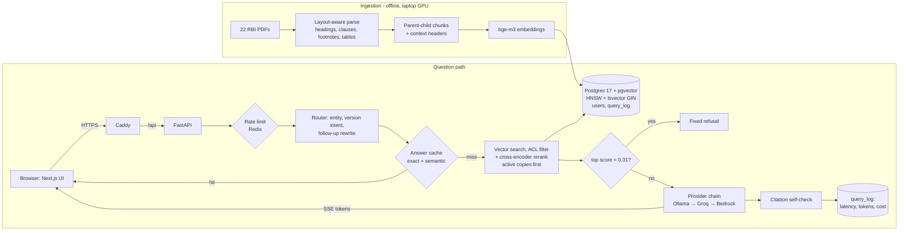

# ComplianceIQ — Architecture

## Components
| Layer | Tech | Code |
|---|---|---|
| UI | Next.js 16 (App Router, TypeScript, Tailwind), streaming answers, source panel, usage page | `frontend/` |
| Edge | Caddy: automatic HTTPS, `/api` → API, SSE without buffering | `deploy/Caddyfile` |
| API | FastAPI (async), one pipeline module, routes only in `main.py` | `backend/app/` |
| Retrieval | bge-m3 vectors in pgvector, bge-reranker-v2-m3 cross-encoder, near-duplicate collapse | `retrieval.py`, `rerank.py` |
| Generation | Provider chain with fallback, prompt with citation rules, deterministic citation check | `providers.py`, `llm.py`, `citations.py` |
| Platform | JWT + bcrypt, document ACL in SQL, Redis cache + rate limit, query log, SQL migrations | `auth.py`, `cache.py`, `ratelimit.py`, `querylog.py`, `migrate.py` |
| Ingestion | PyMuPDF parsing, structure tree, parent/child chunker, idempotent loader | `backend/ingest/`, `scripts/ingest.py` |
| Evals | 175-question golden set, retrieval ablation, generation eval + LLM judge, load test | `evals/` |
| Delivery | GitHub Actions: lint, tests, golden-set check, UI build, Docker build, SSH deploy to EC2 | `.github/workflows/complianceiq-ci.yml` |

## Where it runs
| | Laptop (development) | AWS (demo) |
|---|---|---|
| Machine | RTX 3050 6 GB | EC2 m7i-flex.large (2 vCPU, 8 GB), Mumbai |
| Search models | GPU, fp16 | CPU, fp32, `RERANK_TOP=10` |
| Answers | phi4-mini via Ollama (free) | Groq llama-3.1-8b-instant (free tier); Bedrock optional |
| Data | Docker: Postgres + Redis; API on the host (ADR-007) | Everything in Docker Compose (`deploy/`) |

## Key data model ideas
- **Parent-child chunks:** small child chunks give precise retrieval; their larger parent gives the LLM context.
- **Contextual header:** every chunk is prefixed with "document, section" before embedding.
- **Status:** `documents.status` (active / superseded) drives the "prefer active" rule and UI warnings.
- **Access level:** `documents.access_level` vs `users.access_levels`, enforced inside the retrieval SQL.
