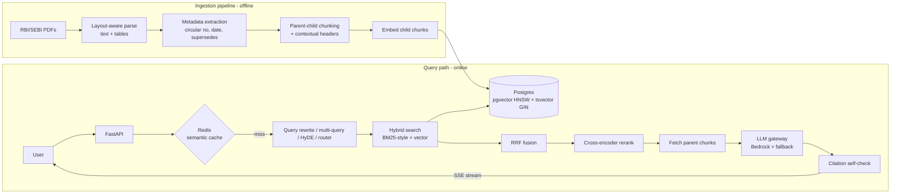

# ComplianceIQ — Architecture

## Components (M0 state)
| Component | Tech | Status |
|---|---|---|
| API | FastAPI (async), uvicorn | `/health` ✅ |
| Store | Postgres 17 + pgvector: `documents`, `chunks` (HNSW cosine, weighted tsvector GIN) | schema ✅ |
| Cache | Redis 7 | connected ✅ |
| Ingestion, retrieval, generation | — | M1–M5 |

## Key data model ideas
- **Parent-child chunks:** small child chunks give precise retrieval; their larger parent gives the LLM enough context.
- **Contextual header:** each chunk is prefixed with "Circular X, dated Y, section Z" before embedding, so a chunk that says only "the above limit" still carries its context.
- **Version graph:** `documents.supersedes` and `status` let answers flag superseded rules.
